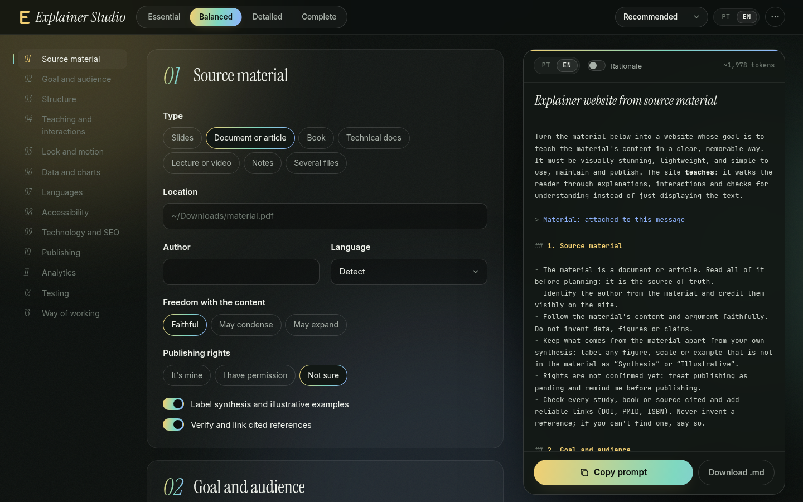

# Explainer Studio

[](LICENSE)

**English** · [Português](README.pt-BR.md)

Explainer Studio is a form that writes the prompt for turning any material (a PDF, a book, a set of notes, a lecture transcript) into an explainer website. You answer as much as you want, copy the prompt, and hand it to a coding agent together with the material.

The prompt carries what usually goes wrong when an agent builds this kind of site: pages that display text instead of teaching it, interactions nobody understands, languages added too late, a domain attached before its DNS existed, analytics that missed the launch, tests left in a temp folder. Each rule can come with its rationale, so the agent can handle the cases the prompt doesn't cover.



## Features

- **Four levels of detail.** Essential, Balanced, Detailed and Complete. Higher levels reveal more questions; the prompt grows with them.
- **Live preview.** The prompt rebuilds on every change and highlights what changed.
- **Prompt in Portuguese or English**, independent of the interface language.
- **Rationale on demand.** One switch appends the reason behind each rule.
- **Agent credit.** Choose whether the agent is credited as a co-author (`Co-Authored-By` trailers, PR note, README credits) or stays invisible in commits, pull requests, code and the site.
- **Starting points.** Recommended, Interactive course, Light read and Showpiece.
- **Sections you can leave out**, questions that only show up when they apply, and undo for every destructive action.
- **Answers as a file.** Export your answers as JSON, import them later, or feed them to the CLI.
- **Private by design.** Runs entirely in your browser. Answers stay in `localStorage`; nothing is sent anywhere.
- **No dependencies, no build.** Open `index.html` and it works, even from `file://`.

## Quick start

Open `index.html` in a browser. That's it.

For a local server (needed for the clipboard API in some browsers):

```sh
npm start        # http://localhost:4173
```

To publish your own copy, serve the repository root from any static host (GitHub Pages, Netlify, Cloudflare Pages…). There is nothing to build.

## Command line

The same builder runs in Node 18+, so scripts and agents can generate prompts without a browser.

```sh
node bin/explainer-studio.js --preset course --level 3 --lang pt
node bin/explainer-studio.js explainer-answers.json --why --out prompt.md
node bin/explainer-studio.js --set name="Photosynthesis 101" --set langs=en,pt --set attribution=invisible
node bin/explainer-studio.js --fields          # every field id, type, level and option
node bin/explainer-studio.js --help
```

After `npm link` (or a global install) the command is just `explainer-studio`.

### Answers file

"Export answers" in the ⋯ menu downloads the same format the CLI reads. Every key is optional; missing values fall back to the preset, then to the defaults.

```json
{
  "level": 3,
  "lang": "en",
  "why": true,
  "preset": "course",
  "off": ["analytics"],
  "values": {
    "name": "Photosynthesis 101",
    "langs": ["en", "pt"],
    "attribution": "invisible"
  }
}
```

## How it works

| File | Role |
| --- | --- |
| `src/schema.js` | Data only: levels, sections, fields, options and presets, each with Portuguese and English text. |
| `src/core.js` | Pure functions: defaults, validation (`normalize`), visibility rules and the prompt builder (`build`). |
| `src/i18n.js` | Interface strings. |
| `src/app.js` | The browser UI: renders the form from the schema and shows the live prompt. |
| `bin/explainer-studio.js` | CLI over `core.js`. |
| `test/` | `node:test` suite: schema integrity, translations, every preset × level × language, the CLI. |

All browser files are classic scripts with a small UMD wrapper, which is what keeps `file://` working and lets Node `require()` them.

A field is used when its section is shown at the chosen level, the section isn't switched off, the field's own level is within reach, and its `when` condition (if any) holds. The UI and the builder share that rule, so what you see is what the prompt says.

## Development

```sh
npm test         # runs the whole suite, no installs needed
npm start        # local server
```

### Adding a question

1. Add the field to a section in `src/schema.js`, with `label` and every option's `label` and `say` in both languages.
2. Use it in `build()` in `src/core.js` through the helpers (`on`, `str`, `say`, `says`, `picked`), so level and visibility are respected.
3. Run `npm test`. The suite fails on missing translations, invalid defaults, unknown preset values and broken Markdown.

### Adding a language

Add its code to `uiLanguages` in `src/schema.js`, then add that key to every `T(...)`/`O(...)` text and to `src/i18n.js`; the tests list anything you missed. The interface is then fully translated. The prompt itself falls back to English until you extend the `L(pt, en)` helper in `src/core.js` and its calls.

## Contributing

Issues and pull requests are welcome. See [CONTRIBUTING.md](CONTRIBUTING.md). Coding agents working on this repository should read [AGENTS.md](AGENTS.md).

## License

[MIT](LICENSE). The bundled fonts (Inter, Instrument Serif, JetBrains Mono) are under the SIL Open Font License 1.1; their licenses are in `src/fonts/`.
