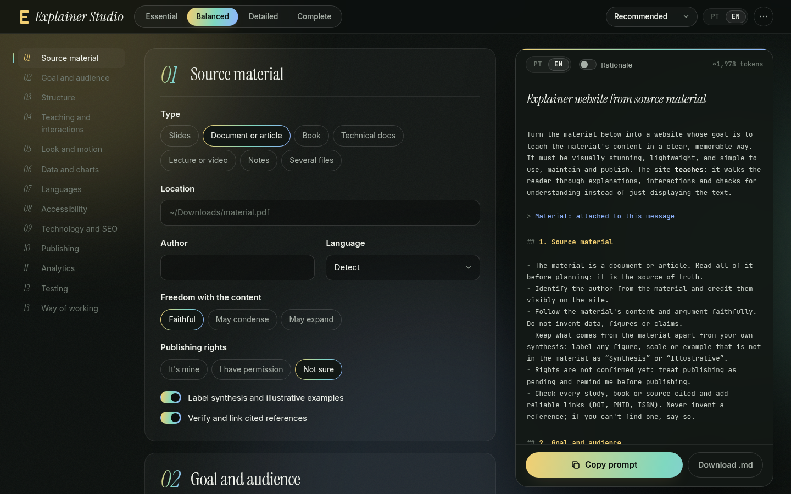

# Explainer Studio

[](LICENSE)

[English](README.md) · **Português**

O Explainer Studio é um formulário que escreve o prompt para transformar qualquer material (um PDF, um livro, um conjunto de notas, a transcrição de uma aula) num site explicativo. Você responde o quanto quiser, copia o prompt e entrega a um agente de código junto com o material.

O prompt já traz o que costuma dar errado quando um agente constrói esse tipo de site: páginas que exibem o texto em vez de ensinar, interações que ninguém entende, idiomas que entram tarde demais, domínio associado antes de o DNS existir, analytics que perdeu o lançamento, testes esquecidos numa pasta temporária. Cada regra pode vir com o seu porquê, para o agente decidir bem os casos que o prompt não cobre.



## Recursos

- **Quatro níveis de detalhe.** Essencial, Equilibrado, Detalhado e Completo. Níveis mais altos revelam mais perguntas, e o prompt cresce junto.
- **Prévia ao vivo.** O prompt é refeito a cada mudança e destaca o que mudou.
- **Prompt em português ou inglês**, independente do idioma da interface.
- **Porquês sob demanda.** Uma chave acrescenta o motivo de cada regra.
- **Crédito do agente.** Escolha se o agente aparece como coautor (trailers `Co-Authored-By`, aviso no PR, créditos no README) ou fica invisível em commits, pull requests, código e no site.
- **Pontos de partida.** Recomendado, Curso interativo, Leitura leve e Vitrine.
- **Seções que podem ficar de fora**, perguntas que só aparecem quando fazem sentido e "desfazer" em toda ação destrutiva.
- **Respostas em arquivo.** Exporte as respostas em JSON, importe depois ou use na linha de comando.
- **Privado por padrão.** Roda inteiro no navegador. As respostas ficam no `localStorage`; nada é enviado.
- **Sem dependências, sem build.** Abra o `index.html` e pronto, inclusive via `file://`.

## Começando

Abra o `index.html` no navegador. Só isso.

Para um servidor local (alguns navegadores exigem para copiar para a área de transferência):

```sh
npm start        # http://localhost:4173
```

Para publicar a sua cópia, sirva a raiz do repositório em qualquer host estático (GitHub Pages, Netlify, Cloudflare Pages…). Não há nada para compilar.

## Linha de comando

O mesmo gerador roda no Node 18+, então scripts e agentes podem gerar prompts sem navegador.

```sh
node bin/explainer-studio.js --preset course --level 3 --lang pt
node bin/explainer-studio.js explainer-answers.json --why --out prompt.md
node bin/explainer-studio.js --set name="Fotossíntese 101" --set langs=pt,en --set attribution=invisible
node bin/explainer-studio.js --fields          # todos os campos, tipos, níveis e opções
node bin/explainer-studio.js --help
```

Depois de `npm link` (ou de instalar globalmente), o comando é só `explainer-studio`.

### Arquivo de respostas

"Exportar respostas", no menu ⋯, baixa o mesmo formato que a CLI lê. Todas as chaves são opcionais; o que faltar vem do ponto de partida e, depois, dos padrões.

```json
{
  "level": 3,
  "lang": "pt",
  "why": true,
  "preset": "course",
  "off": ["analytics"],
  "values": {
    "name": "Fotossíntese 101",
    "langs": ["pt", "en"],
    "attribution": "invisible"
  }
}
```

## Como funciona

| Arquivo | Papel |
| --- | --- |
| `src/schema.js` | Só dados: níveis, seções, campos, opções e pontos de partida, com textos em português e inglês. |
| `src/core.js` | Funções puras: padrões, validação (`normalize`), regras de visibilidade e o gerador do prompt (`build`). |
| `src/i18n.js` | Textos da interface. |
| `src/app.js` | A interface no navegador: monta o formulário a partir do schema e mostra o prompt ao vivo. |
| `bin/explainer-studio.js` | CLI sobre o `core.js`. |
| `test/` | Testes com `node:test`: integridade do schema, traduções, todo ponto de partida × nível × idioma, a CLI. |

Os arquivos do navegador são scripts clássicos com um pequeno invólucro UMD: é isso que mantém o `file://` funcionando e permite ao Node fazer `require()`.

Um campo entra no prompt quando a seção aparece no nível escolhido, não está desligada, o nível do campo é alcançado e a condição `when` (se houver) é verdadeira. A interface e o gerador usam a mesma regra: o que você vê é o que o prompt diz.

## Desenvolvimento

```sh
npm test         # roda todos os testes, sem instalar nada
npm start        # servidor local
```

### Adicionando uma pergunta

1. Acrescente o campo a uma seção em `src/schema.js`, com `label` e, em cada opção, `label` e `say` nos dois idiomas.
2. Use-o em `build()`, no `src/core.js`, pelos helpers (`on`, `str`, `say`, `says`, `picked`), para respeitar nível e visibilidade.
3. Rode `npm test`. Os testes falham com tradução faltando, padrão inválido, valor desconhecido em ponto de partida e Markdown quebrado.

### Adicionando um idioma

Acrescente o código em `uiLanguages` no `src/schema.js` e depois a chave em todo texto `T(...)`/`O(...)` e no `src/i18n.js`; os testes apontam o que faltar. Com isso a interface fica toda traduzida. O prompt em si usa inglês até você estender o helper `L(pt, en)` do `src/core.js` e as suas chamadas.

## Contribuindo

Issues e pull requests são bem-vindos. Veja o [CONTRIBUTING.md](CONTRIBUTING.md). Agentes de código trabalhando neste repositório devem ler o [AGENTS.md](AGENTS.md).

## Licença

[MIT](LICENSE). As fontes incluídas (Inter, Instrument Serif, JetBrains Mono) usam a SIL Open Font License 1.1; as licenças estão em `src/fonts/`.
